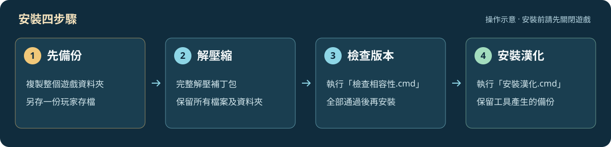
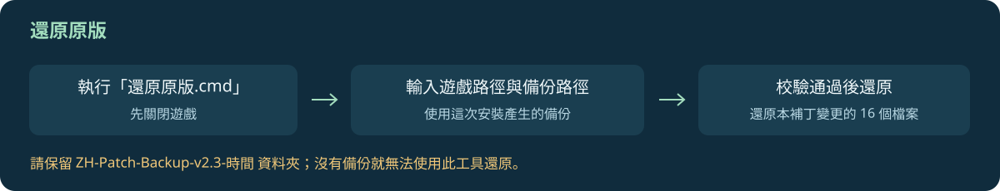

> [!WARNING]
> **安裝前務必自行備份完整遊戲資料夾與玩家存檔！**
> 請將備份放在另一個資料夾，確認可以讀取後再操作。安裝工具的自動備份只涵蓋本補丁變更的檔案，**不能取代您的完整備份**。


<p align="center">
  <a href="https://github.com/cotdeartstudio-arch/Zeus-Poseidon-Traditional-Chinese/releases"><b>下載漢化補丁</b></a> ·
  <a href="#安裝方式">安裝方式</a> ·
  <a href="#還原原版">還原原版</a> ·
  <a href="https://github.com/cotdeartstudio-arch/Zeus-Poseidon-Traditional-Chinese/issues">問題回報</a>
</p>

## 使用前聲明

> **本補丁免費提供，僅供已合法持有原版遊戲的玩家使用。**

- **適用於 Steam 版《Zeus + Poseidon》英文原版遊戲**；實際相容性以工具對全部檔案的校驗結果為準。
- 本專案為玩家製作的**非官方繁體中文漢化補丁**，非遊戲官方發布或授權背書。
- 本補丁不包含完整遊戲，也不提供原版遊戲的購買或使用授權；請自行合法取得原版。
- 遊戲名稱、商標、原始文字、美術與其他原始素材，其權利屬於各原權利人。部分譯文與字形沿用官方中文版並經繁體整理及修正。
- 本次分享**不包含修改器、修改器原始碼、語音包、音樂、玩家存檔或個人設定**。
- 不保證所有電腦環境、其他商店版本或其他模組相容。請先備份；遇到異常可使用隨附工具還原。

免費提供不等於將原遊戲或其素材宣告為開源；本專案尚未指定整體開源授權。完整聲明另附於 [使用前必讀](patch/使用前必讀.md)。

## 漢化內容

| 內容 | 本版整理範圍 |
| :--- | :--- |
| 🏛️ 遊戲文字 | 選單、建築資訊、提示、事件訊息、劇情及冒險文字 |
| 🗺️ 地圖與編輯器 | 地圖編輯器文字、世界地圖地名、貿易港名稱對應 |
| 🔤 字體與介面 | 繁體中文字庫，以及字級、字色、置中和行距調整 |
| 📖 名稱統一 | 橘子、山銅、奶酪、盔甲、稅務所、英雄府邸等用語 |
| ↩️ 安裝與還原 | 相容性檢查、自動備份、漢化安裝及原版還原工具 |

本版整理自目前使用的 **V2.2**。不改動音檔，遊戲沿用安裝前已有的語音。尚未逐一完成所有遊戲畫面的實機驗收；部分未確認用途的英文、內部識別字、檔名與預留欄位保留原樣。

## 安裝方式



1. **先備份。** 關閉遊戲，將完整遊戲資料夾及玩家存檔複製到另一個位置。另有存放於遊戲資料夾外的存檔，也請一併備份。
2. **下載並解壓縮。** 從 [Releases](https://github.com/cotdeartstudio-arch/Zeus-Poseidon-Traditional-Chinese/releases) 下載 `Zeus-Poseidon-ZH-TW-v2.2.zip`。請完整解壓，保留 `payload` 資料夾及所有同層檔案。
3. **檢查相容性。** 雙擊 `檢查相容性.cmd`，輸入含有 `zeus.exe` 的遊戲資料夾完整路徑。這一步不變更遊戲檔案。
4. **安裝漢化。** 檢查通過後，雙擊 `安裝漢化.cmd`，輸入同一個遊戲資料夾。
5. **保留備份。** 出現安裝完成訊息後即可照常開啟遊戲；請保留遊戲資料夾內的 `ZH-Patch-Backup-v2.2-時間`，日後還原會用到。

> [!TIP]
> 也可下載本儲存庫 ZIP，解壓後在 `patch` 資料夾執行工具。中文與英文檔名的入口功能相同，不必重複執行。

| 操作 | 中文入口 | 英文入口 |
| :--- | :--- | :--- |
| 檢查版本及補丁完整性 | `檢查相容性.cmd` | `Check.cmd` |
| 安裝漢化並備份原檔 | `安裝漢化.cmd` | `Install.cmd` |
| 從安裝備份還原原版 | `還原原版.cmd` | `Restore.cmd` |

工具使用 Windows 內建 PowerShell，不需安裝 Python。更詳細的操作說明見 [安裝說明](patch/安裝說明.md)。

## 還原原版



1. 關閉遊戲。若安裝後又繼續遊玩，先另外備份最新存檔。
2. 雙擊補丁資料夾內的 **`還原原版.cmd`**。
3. 輸入遊戲資料夾完整路徑，再輸入本次安裝建立的 **`ZH-Patch-Backup-v2.2-時間`** 備份資料夾完整路徑。
4. 工具核對目前檔案及備份後，還原本補丁變更的 **16 個檔案**，並恢復安裝時暫停使用的已識別 `.chn` 資源。

還原工具不改動存檔、音檔與個人設定，也不會撤銷其他工具造成的變更。若目前檔案已被其他補丁改寫，或備份損壞，工具會停止，避免直接覆蓋。

> [!IMPORTANT]
> **還原工具需要本次安裝時建立的備份，無法憑空重建遺失的原檔。**
> 請勿刪除、修改或混用其他版本的備份。若備份遺失，請使用自己事先保存的完整原版備份。

## 相容性與已知限制

- 目前只驗證本專案所比對的 **Steam 英文原版**；工具會核對全部 16 個檔案，版本不符就停止。
- 此包適用於乾淨原版，不是舊版漢化的增量更新。已套用其他漢化、其他補丁或混用檔案時，請先恢復相容原版。
- 尚未確認其他商店版本、官方中文版或其他模組的相容性。
- 已在隔離副本完成重建校驗、安裝、重複安裝辨識、還原、重新檢查及不相容檔案拒絕測試；這不等同完整遊戲流程驗收。

<details>
<summary>查看版本校驗資訊</summary>

原版 `zeus.exe` 的 SHA-256：

```text
382bcd286192a06eb8fdc45f5c37390a19999f5db9c940c3ce2dfcd775e90a57
```

漢化後 `zeus.exe` 的 SHA-256：

```text
f81aac1f9ade5698f89eb1560061c03461165a59f56b553bfb118c67e38504b7
```

完整檔案校驗清單見 [manifest.json](patch/manifest.json)，測試結果見 [驗證記錄](docs/驗證記錄.json)。

</details>

## 問題回報

歡迎透過 [Issues](https://github.com/cotdeartstudio-arch/Zeus-Poseidon-Traditional-Chinese/issues) 回報漏翻、名稱不一致或排版問題。請附上補丁版本、Steam 遊戲版本、重現步驟及截圖；安裝失敗時請一併提供錯誤訊息。

## 專案檔案

| 路徑 | 用途 |
| :--- | :--- |
| `patch/` | 安裝、檢查、還原工具、使用聲明及差異補丁 |
| `translations/` | 目前遊戲文字的 UTF-8 匯出、字碼表與神名對照 |
| `tools/` | 差異資料產生與驗證工具 |
| `docs/` | 操作示意圖與驗證記錄 |

文字匯出用於查閱與校對，修改 JSON 不會自動改寫補丁。主程式與字庫以差異形式提供，需要相符的原版檔案才能重建。
