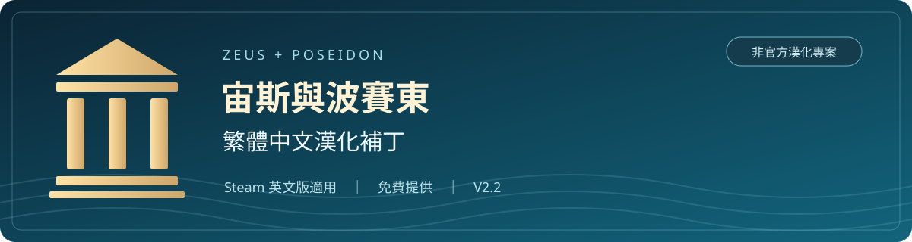
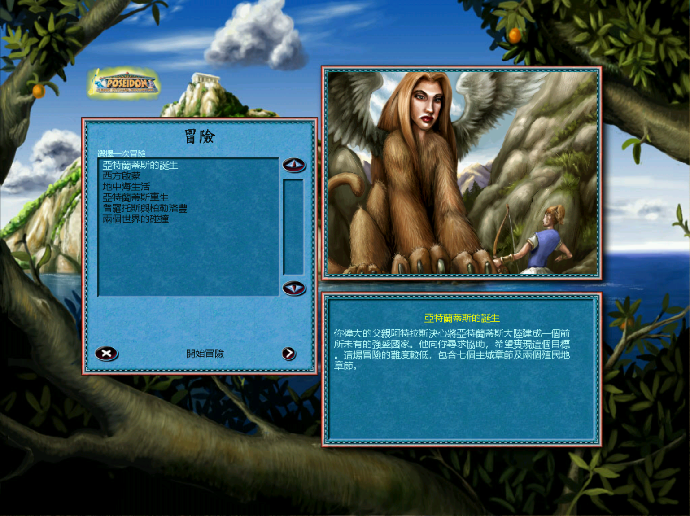
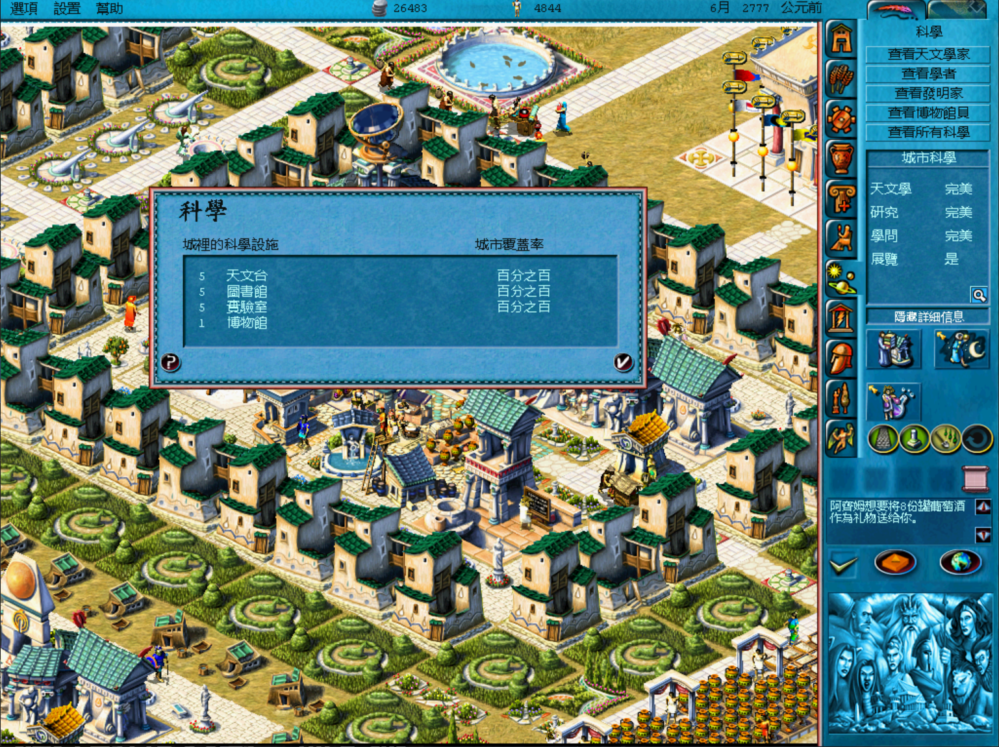
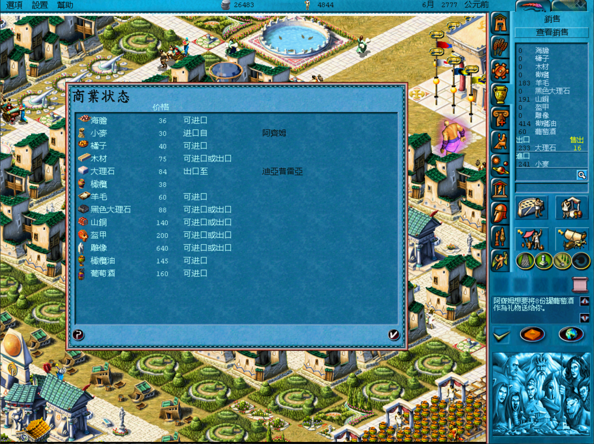
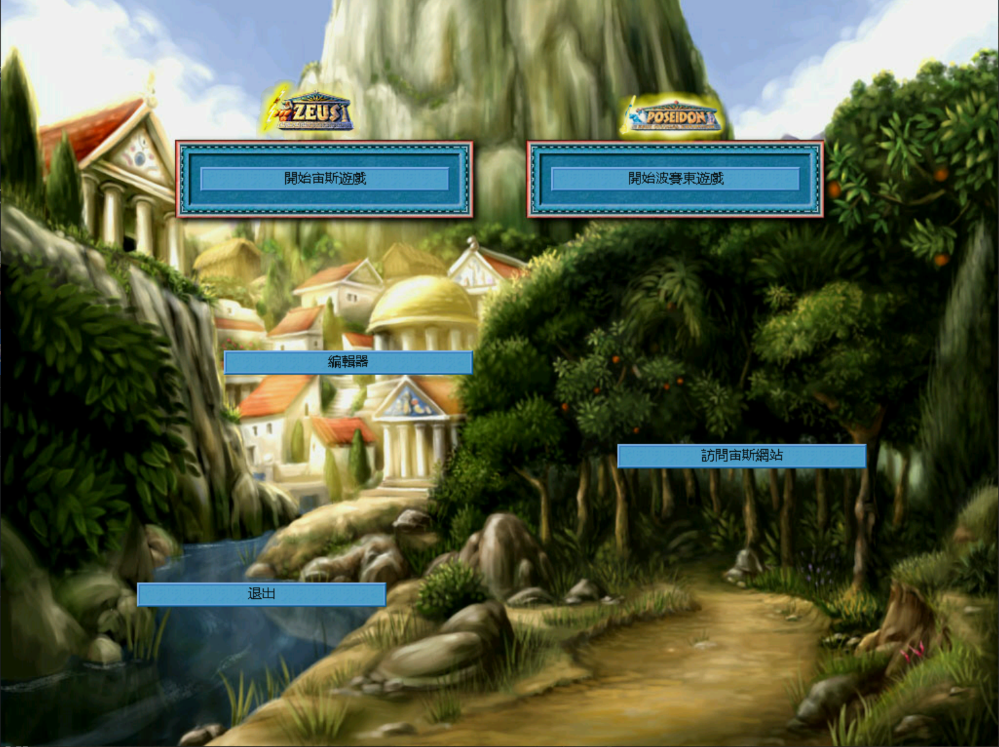
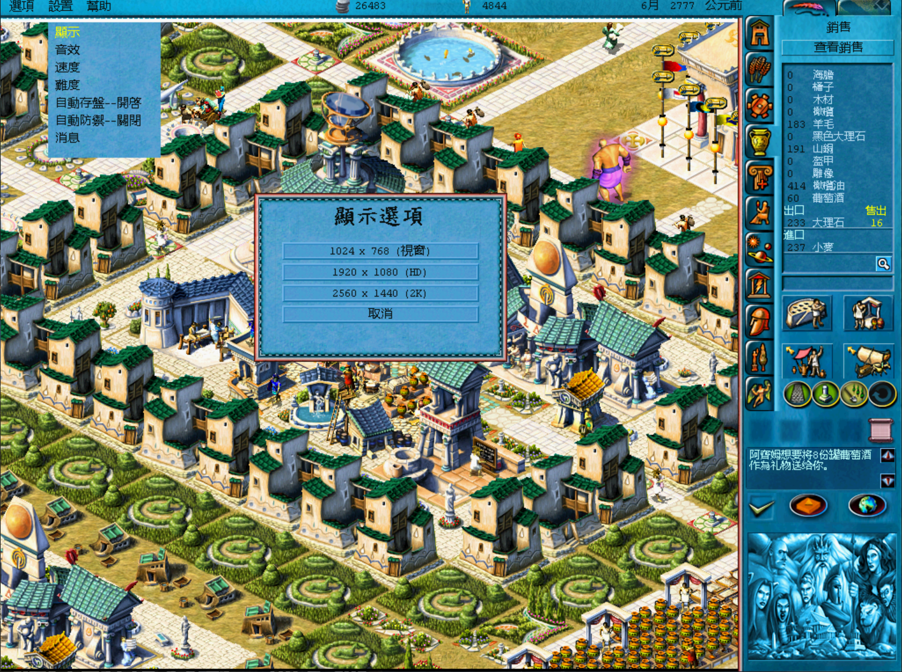

> [!WARNING]
> **安裝前務必自行備份完整遊戲資料夾與玩家存檔！**
> 請將備份放在另一個資料夾，確認可以讀取後再操作。安裝工具的自動備份只涵蓋本補丁變更的檔案，**不能取代您的完整備份**。

  <a href="https://github.com/cotdeartstudio-arch/Zeus-Poseidon-Traditional-Chinese/releases"><b>下載漢化補丁</b></a> ·
  <a href="#安裝方式">安裝方式</a> ·
  <a href="#還原原版">還原原版</a> ·
  <a href="https://github.com/cotdeartstudio-arch/Zeus-Poseidon-Traditional-Chinese/issues">問題回報</a>

## 使用前聲明

> **本補丁免費提供，僅供已合法持有原版遊戲的玩家使用。**

- **適用於 Steam 版《Zeus + Poseidon》英文原版遊戲**；實際相容性以工具對全部檔案的校驗結果為準。
- 本專案為玩家製作的**非官方繁體中文漢化補丁**，非遊戲官方發布或授權背書。
- 本補丁不包含完整遊戲，也不提供原版遊戲的購買或使用授權；請自行合法取得原版。
- 遊戲名稱、商標、原始文字、美術與其他原始素材，其權利屬於各原權利人。部分譯文與字形沿用官方中文版並經繁體整理及修正。
- 本次分享**不包含修改器、修改器原始碼、語音包、音樂、玩家存檔或個人設定**。
- 不保證所有電腦環境、其他商店版本或其他模組相容。請先備份；遇到異常可使用隨附工具還原。

免費提供不等於將原遊戲或其素材宣告為開源；本專案尚未指定整體開源授權。完整聲明另附於 [使用前必讀](patch/使用前必讀.md)。

## 下載哪一份？

| 下載檔案 | 用途 | 安裝順序 |
| --- | --- | --- |
| **Zeus-Poseidon-ZH-TW-v2.3.zip** | 繁體中文漢化，保留原版解析度與動畫速度 | 先安裝這份 |
| **Zeus-Poseidon-HD-Animation-v2.3.zip** | HD／2K 解析度＋動畫速度修正，另附所需背景與世界地圖配套 | 有需要才加裝；需要先安裝 v2.3 漢化 |

**兩份分開下載、分開安裝。漢化安裝程式不會自動安裝 HD／2K 或動畫修正。**

兩份皆不包含跳過開場動畫，也不變更語音、修改器、存檔或個人設定。

## 遊戲畫面

以下截圖拍攝於已啟用 HD／2K 與動畫修正的遊戲，展示繁體中文介面；單獨安裝漢化仍使用原版解析度。點擊圖片可查看完整尺寸。

### 冒險選擇與劇情簡介

| 科學設施與城市評價 | 商業狀態與商品名稱 |
| :---: | :---: |
|  |  |

<b>查看更多：主選單與 HD／2K 顯示選項</b>

**繁體中文主選單**

**視窗、HD 與 2K 選項**

安裝選裝包後，選單提供 1024×768 視窗、1920×1080（HD）與 2560×1440（2K）。此圖展示選項內容，不代表截圖本身為 2K 解析度。

## 漢化內容

- 遊戲選單、建築資訊、提示、事件、劇情與冒險文字。
- 地圖編輯器文字、地名及貿易港名稱對應。
- 繁體中文字庫與字級、字色、置中、行距調整。
- 統一橘子、山銅、奶酪、盔甲、稅務所、英雄府邸等用語。

漢化包共變更 **16 個檔案**，保留原版 640×480、800×600、1024×768 的解析度模式及原有動畫速度。中文字庫隨補丁重建，不需另外安裝同名字型。

漢化所需的文字顯示修正仍保留；另保留既有的特定圖像越界閃退防護。該防護不改動畫速度，也不保證排除所有閃退。部分未確認用途的英文、內部識別字、檔名與預留欄位仍保留原樣。

## 選裝：HD／2K＋動畫速度修正

需要先完整安裝 **v2.3 漢化包**。這份選裝包不適用於未漢化原版，也不能直接覆蓋 v2.2／v2.2.1 整合補丁。

| 功能 | 內容 |
| --- | --- |
| 顯示選項 | 1024×768 視窗、1920×1080（HD）、2560×1440（2K） |
| 動畫速度 | 70 處動畫參數修正，包含神明、海膽採集等原有慢速動作 |
| 畫面配套 | 寬螢幕側欄、邊框、視窗相容性及世界地圖定位 |
| 背景配套 | 24 張選單／載入背景與 14 張世界地圖的差異資料；不是高清重繪材質包 |

選裝包共變更 **40 個檔案**：主程式、顯示選單文字及 38 張圖片。單獨撤除後會保留 v2.3 漢化，回到原版解析度與動畫速度。

## 安裝方式

1. **備份完整遊戲資料夾及玩家存檔，並關閉遊戲。**
2. 到 [Releases](https://github.com/cotdeartstudio-arch/Zeus-Poseidon-Traditional-Chinese/releases) 下載 `Zeus-Poseidon-ZH-TW-v2.3.zip`，完整解壓。
3. 執行漢化包的 **`檢查相容性.cmd`**，輸入含 `zeus.exe` 的 Steam 英文原版遊戲資料夾；通過後執行 **`安裝漢化.cmd`**。
4. 想要 HD／2K 與動畫修正，再下載 `Zeus-Poseidon-HD-Animation-v2.3.zip`，**解壓到另一個資料夾**。
5. 執行選裝包的 **`檢查相容性.cmd`**，通過後執行 **`安裝HD與動畫修正.cmd`**，指定同一個遊戲資料夾。
6. 保留兩次安裝產生的備份。只需要漢化的玩家做到第 3 步即可。

> [!IMPORTANT]
> 兩份 ZIP 內都有 `Patch.ps1`、`manifest.json` 和 `payload`，請分開解壓，勿混放或互相覆蓋。

若下載整個儲存庫，漢化位於 `patch/`，選裝包位於 `optional-hd/`。

## 還原原版

| 要做什麼 | 執行工具 | 使用哪份備份 |
| --- | --- | --- |
| 只撤除 HD／2K 與動畫修正，保留漢化 | 選裝包的 `撤除HD與動畫修正.cmd` | `ZH-Patch-Backup-v2.3-HD-時間` |
| 撤除漢化、還原原版 | 漢化包的 `還原原版.cmd` | `ZH-Patch-Backup-v2.3-時間` |

**如果兩份都有安裝，務必先撤除選裝包，再還原漢化。** 工具會檢查檔案及備份，拒絕錯誤順序、損壞備份或後續被改動的檔案。

自動備份只涵蓋補丁變更的檔案，無法取代完整備份。不要刪除備份資料夾；遺失時請使用自己保存的完整原版備份。

## 已安裝 v2.2／v2.2.1 整合補丁

1. 先備份完整遊戲及最新存檔，關閉遊戲。
2. 在新漢化包中執行對應的 **`還原舊版v2.2.cmd`** 或 **`還原舊版v2.2.1.cmd`**，指定當時安裝產生的同版本備份。
3. 回到原版後，再依上方順序安裝 v2.3 漢化及需要的選裝包。

不能直接覆蓋升級。舊備份遺失時，請先用自己保留的完整原版備份恢復遊戲。

## 開場動畫

**這兩份補丁都不包含跳過開場動畫。** 安裝器不移動、改名或停用開場影片，已核對的主程式開場播放流程與 Steam 原版相同。若安裝前影片已被其他工具移除或停用，補丁不會將它們補回。

## 驗證與限制

已完成兩份差異包重建、安裝／撤除、錯誤順序拒絕、損壞資料防護，以及解析度和動畫參數驗證。安裝選裝包後的 54 個目標檔案與現用 V2.2 整合版一致。語音、存檔、設定與開場影片的測試檔保持不變。

尚未完成所有遊戲畫面的實機遊玩驗收。程式與檔案測試不代表每一個解析度、冒險或電腦環境均已實測。

- [漢化檔案校驗清單](patch/manifest.json)
- [選裝包檔案校驗清單](optional-hd/manifest.json)
- [驗證紀錄](docs/驗證記錄.json)
- [使用前必讀](patch/使用前必讀.md)

## 問題回報

請到 [Issues](https://github.com/cotdeartstudio-arch/Zeus-Poseidon-Traditional-Chinese/issues) 提供補丁版本、是否加裝 HD／2K、重現步驟及截圖。

## 專案檔案

| 路徑 | 用途 |
| --- | --- |
| `patch/` | 繁體中文漢化、校驗與還原工具 |
| `optional-hd/` | HD／2K 與動畫速度修正的獨立安裝、校驗與撤除工具 |
| `translations/` | 文字匯出、字碼表與神名對照，供查閱校對 |
| `docs/` | 實際遊戲截圖及驗證紀錄 |
| `tools/` | 差異資料工具 |

修改文字匯出檔不會自動更新補丁。主程式、字庫及圖片以差異形式提供，需要相符的遊戲檔案才能重建。

## 第三方致謝

寬螢幕及動畫修復研究：XJDHDR、Pecunia 與 Impressions Resolution Customiser 貢獻者。

This product includes software developed by XJDHDR and contributors for the Impressions Resolution Customiser project.

兩份安裝包皆附 `第三方研究來源授權.txt`。
